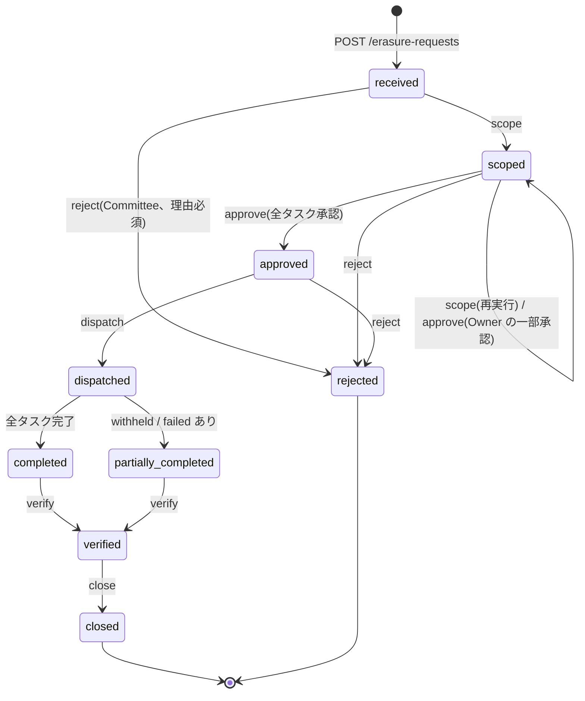
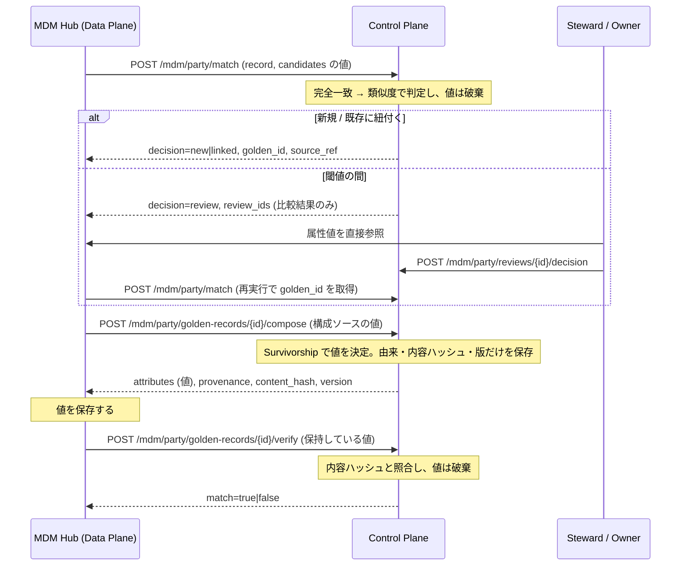
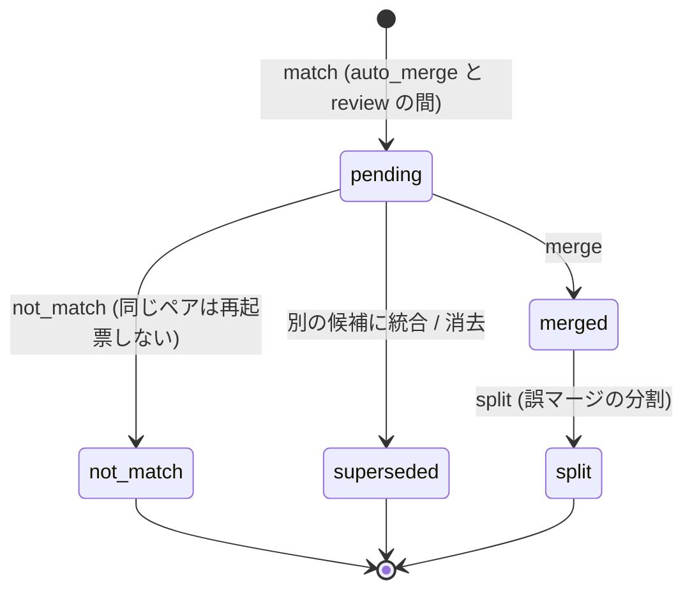

# Enterprise Data Governance Framework — Governance Control Plane

「Enterprise Data Governance Framework 設計書」の実装です。製品に依存しない(Cloud Agnostic)**Governance Control Plane** として、
メタデータ・統制の状態・証跡だけを持ち、**データ本体は持ちません**(設計書 §18.2)。

## 実装範囲(成熟度 Level 2〜3 相当)

| 設計書 | 機能 | API (`/api/v1`) |
|---|---|---|
| §3 / §6 / §7 | Catalog登録・横断検索(用語・タグ含む)・分類・機密度・PII自動推定 | `/assets`, `/domains` |
| §4 | Owner / Steward / Custodian の割当、Owner不在(Unknown Owner)の検出 | `/assets/{id}/ownership`, `/assets?orphan=true` |
| §6.2 | Business Glossary(用語とデータ資産の紐付け) | `/glossary/terms` |
| §7 | Certificationゲート(Owner・品質SLA・高重大度ポリシーを満たすこと) | `/assets/{id}/certification[/check]` |
| §10 | ライフサイクルの状態遷移、Legal Hold、保持期限切れの検出 | `/assets/{id}/lifecycle`, `/assets/retention-due` |
| §5 | 7ディメンションの品質ルール・Quality Score・閾値割れ時のIssue自動起票 | `/quality/...` |
| §16 | Issue管理・エスカレーション(Steward→Owner→Committee)・SLA超過時の自動エスカレーション | `/issues` |
| §9 | OpenLineage互換の取込・上流/下流トレース・影響分析(通知先Owner・リスク判定) | `/lineage/...` |
| §13 / §15 | Policy as Code(Global/Domain YAML、上書き禁止)・自動監査・期限付き例外の承認(職務分離あり) | `/policies/...` |
| §13 / §19 | ハッシュチェーン監査ログ・改ざんの検知 | `/audit/events`, `/audit/verify` |
| §17 / §20 | KPI(全社・ドメイン別)・成熟度の目安 | `/kpi`, `/kpi/domains` |
| §19 | スキーマ版管理(Alembic)・統一エラーモデル(RFC 9457)・ページネーション・構造化ログ/request_id・liveness/readiness | `/health`, `/ready` |
| §12 / §10 | PII Inventory(カラム単位)・Consent Registry・Right to Erasure ワークフロー・匿名化/仮名化の管理(PRV-003〜005) | `/privacy/...` |
| §8 | Golden Record(値は持たず、xref・由来・版の情報のみ)、2 段階のマッチング、Survivorship、裁定キュー、as-of、Reference Data の版管理 | `/mdm/...`, `/reference-data/...` |
| §4 / §11 | 認証(OIDC JWT / 開発用 dev モード)・RBAC・資産ごとの Owner/Steward 判定・ABAC(機密度×clearance)・閲覧承認・拒否の証跡 | 全 API、`/assets/{id}/access-grants` |

## 起動

```bash
# ローカル (SQLite, dev モード)
pip install -e ".[dev]"
alembic upgrade head                  # スキーマ作成/更新 (EDGF_DATABASE_URL の DB に対して)
EDGF_AUTH_MODE=dev uvicorn edgf.main:app --reload --no-access-log   # http://localhost:8000/docs
./scripts/demo.sh                     # サンプルデータの投入 (dev モード前提)
pytest -q --cov=edgf

# PostgreSQL (docker compose)
docker compose -f docker-compose.yml -f docker-compose.dev.yml up --build   # 開発: dev モード
docker compose up --build             # 既定: jwt モード (EDGF_OIDC_* が必要。未設定なら起動しない)
```

| 環境変数 | 既定 | 説明 |
|---|---|---|
| `EDGF_DATABASE_URL` | `sqlite:///./edgf.db` | SQLAlchemy URL(例: `postgresql+psycopg://...`) |
| `EDGF_POLICY_DIR` | `./policies` | Policy as Code の YAML |
| `EDGF_CERT_MIN_QUALITY` | `0.99` | Certification に必要な Quality Score |
| `EDGF_ISSUE_SLA_DAYS` | `30` | Issue 是正 SLA(日) |
| `EDGF_AUTO_MIGRATE` | `false` | 起動時に `alembic upgrade head` を実行する(開発用。本番はデプロイ手順で明示実行) |
| `EDGF_LOG_LEVEL` / `EDGF_LOG_FORMAT` | `INFO` / `json` | ログレベル / `json` または `text` |
| `EDGF_OTEL_ENABLED` | `false` | OpenTelemetry トレーシング(`pip install ".[otel]"` が必要。送信先は `OTEL_EXPORTER_OTLP_ENDPOINT` 等の OTel 標準変数、サービス名は `OTEL_SERVICE_NAME`) |
| `EDGF_ENV` | `development`(Docker では `production`) | `production` のとき dev モードと非 https の JWKS を拒否する |
| `EDGF_AUTH_MODE` | `jwt` | `jwt`(OIDC)または `dev`(開発専用)。後述の「認証」を参照 |
| `EDGF_SUBJECT_KEY` | (production では必須) | `subject_ref` の HMAC 鍵。32 バイト以上。後述の「Data Privacy」を参照 |
| `EDGF_ERASURE_SLA_DAYS` | `30` | 消去要求の対応期限(日) |
| `EDGF_MDM_REVIEW_SLA_DAYS` | `7` | MDM の裁定キューの対応期限(日) |
| `EDGF_MIN_K_ANONYMITY` | `5` | `anonymized` と宣言するために必要な k-匿名性の下限(PRV-003) |

### スキーマ変更(Alembic)

```bash
alembic revision --autogenerate -m "add xxx"   # モデル変更後に生成し、内容をレビューしてコミット
alembic upgrade head
```

`tests/test_platform.py` はモデルとマイグレーションの差分がゼロであることを検査します(マイグレーションの作り忘れを CI で検出するため)。
MVP(v0.1, `create_all`)で作成済みの既存 DB は、スキーマが同一であれば `alembic stamp 0001` で管理下に移せます。ただし PostgreSQL では制約名が自動命名(例: `audit_events_prev_hash_key`)のままになるため、以後のマイグレーションで制約を変更する前に命名規約(`uq_<table>_<column>` など)へリネームしてください。

## 認証(§4 / §11)

`EDGF_AUTH_MODE` で方式を切り替えます。`/health` と `/ready` 以外の API はすべて認証が必要です。

| モード | 操作者の特定 | 用途 |
|---|---|---|
| `jwt`(既定) | `Authorization: Bearer <JWT>`。署名・`iss`・`aud`・`exp`・`nbf` を検証します。トークンが無い・不正なら 401 で、`X-Actor` は無視します | 本番・検証環境 |
| `dev` | `X-Actor`(必須)、`X-Roles` / `X-Domains` / `X-Clearance`(任意)ヘッダ | ローカル開発・移行期間 |

### jwt モードの設定(IdP 製品に依存しない)

| 環境変数 | 既定 | 説明 |
|---|---|---|
| `EDGF_OIDC_ISSUER` / `EDGF_OIDC_AUDIENCE` | (必須) | 期待する `iss` / `aud` |
| `EDGF_OIDC_JWKS_URL` | (必須) | IdP の JWKS エンドポイント。`EDGF_ENV=production` では https のみ |
| `EDGF_OIDC_ALGORITHMS` | `RS256` | 許可する署名アルゴリズム(カンマ区切り)。非対称鍵(RS/PS/ES/EdDSA)のみ指定可 |
| `EDGF_JWT_LEEWAY_SECONDS` | `30` | `exp`/`nbf` の時計ずれ許容 |
| `EDGF_JWKS_CACHE_SECONDS` / `EDGF_JWKS_REFRESH_COOLDOWN_SECONDS` | `300` / `30` | JWKS のキャッシュ期間と、未知の `kid` による再取得の最短間隔(鍵ローテーション対応) |
| `EDGF_CLAIM_SUBJECT` | `sub` | 操作者 ID にする claim。資産の `owner`/`steward` と照合されます(例: `preferred_username`, `email`) |
| `EDGF_CLAIM_ROLES` / `EDGF_CLAIM_DOMAINS` / `EDGF_CLAIM_CLEARANCE` | `roles` / `domains` / `clearance` | ドット区切りでネストした claim も指定できます(例: `realm_access.roles`)。値は配列か、空白/カンマ区切りの文字列 |
| `EDGF_ROLE_MAP` | (なし) | IdP のロール/グループ名 → edgf ロール(例: `dg-committee=committee,dg-admins=admin`) |

設定が足りない、または対称鍵アルゴリズム(HS256 など)を指定した場合は、起動時に停止します。JWKS に到達できないときは、認可を fail-close にするため 503 を返します。

```bash
TOKEN=$(...)   # IdP から取得したアクセストークン (aud = EDGF_OIDC_AUDIENCE)
curl -H "Authorization: Bearer $TOKEN" http://localhost:8000/api/v1/assets
curl -H "Authorization: Bearer $TOKEN" -H 'Content-Type: application/json' \
     -X POST http://localhost:8000/api/v1/assets -d '{"qualified_name":"sales.orders", ...}'
```

トークンの claim の例(既定の claim 名の場合):
`{"iss": "...", "aud": "edgf-control-plane", "sub": "hanako", "exp": ..., "roles": ["steward"], "domains": ["sales"], "clearance": "confidential"}`

### dev モードの安全策

- `EDGF_ENV=production` と同時に指定すると、起動時に例外を出して停止します。
- 起動時に WARNING ログを出し、`/health` の応答に `"auth_mode": "dev"` を含めます(外形監視で検知できます)。
- 監査ログの actor は `dev:<名前>` で記録し、JWT 由来の操作と区別します。
- Dockerfile と `docker-compose.yml` の既定は jwt です。dev モードは `docker-compose.dev.yml`(override)でだけ有効になります。

```bash
curl -H 'X-Actor: steward1' -H 'X-Roles: steward' -H 'X-Domains: sales' http://localhost:8000/api/v1/assets
```

## 認可(§4 / §11)

認可の判定は [edgf/authz.py](edgf/authz.py) に集約し、権限表 `PERMISSIONS` で宣言的に定義しています。各操作は、次のいずれかを満たせば許可されます。

- **ロール**(RBAC): `admin` / `committee` / `owner` / `steward` / `custodian` / `consumer` / `consent_collector`。認証済みの全員に `consumer` が付きます。ただし `consent_collector` だけを持つ主体は除きます。これは同意取得システムのサービスアカウント専用で、`privacy.consent.*` だけを許可する最小権限のロールです(既定の clearance は public)
- **ドメイン内ロール**: 対象資産のドメインが Principal の `domains` に含まれる場合だけ有効なロール(`*` は全ドメイン)
- **対象との関係**: 資産の `owner` / `steward` / `custodian` が JWT の subject と一致すること(Issue は `assignee`)

承認行為(✓)に Custodian を含めることはできず、そのような定義はロード時にエラーになります(§4 Business Ownership)。権限が無い操作は 403 になり、`authz.denied` として監査ログに記録します(リクエスト自体は巻き戻し、拒否の証跡だけを確定させます)。

| アクション | 内容 | 許可される主体 | 承認 |
|---|---|---|---|
| `asset.access_grant` | 閲覧の承認 (§4.2 アクセス承認 A/R) | 対象の owner | ✓ |
| `asset.access_grant.read` | 閲覧承認の一覧 | ロール: admin, committee<br>対象の owner / steward |  |
| `asset.access_revoke` | 閲覧承認の取消 | ロール: committee<br>対象の owner |  |
| `asset.certify` | Certification の変更 | 対象の owner / steward | ✓ |
| `asset.delete` | 削除指示 (§10.1 Delete) | ロール: committee<br>対象の owner | ✓ |
| `asset.legal_hold` | Legal Hold の設定/解除 | ロール: committee<br>対象の owner | ✓ |
| `asset.ownership_change` | Owner/Steward/Custodian の割当 | ロール: admin, committee | ✓ |
| `asset.refresh_notify` | Data Plane からの更新通知 | ロール: admin<br>ドメイン内ロール: custodian, owner, steward<br>対象の custodian / owner / steward |  |
| `asset.register` | 資産の登録 | ロール: admin<br>ドメイン内ロール: owner, steward |  |
| `asset.update` | 資産メタデータの更新・ライフサイクル遷移 (削除以外) | ロール: admin<br>ドメイン内ロール: owner, steward<br>対象の owner / steward |  |
| `audit.read` | 監査ログの参照 | ロール: admin, committee |  |
| `domain.create` | ドメインの新設 | ロール: admin, committee |  |
| `exception.decide` | ポリシー例外の承認/却下 | ロール: admin, committee | ✓ |
| `exception.request` | ポリシー例外の申請 | ロール: admin<br>ドメイン内ロール: owner, steward<br>対象の owner / steward |  |
| `glossary.link` | 用語と資産の紐付け | ロール: admin<br>ドメイン内ロール: owner, steward<br>対象の owner / steward |  |
| `glossary.write` | 用語の作成 | ロール: admin, owner, steward |  |
| `issue.create` | Issue の起票 (Consumer の品質報告を含む) | 認証済みの全員 |  |
| `issue.escalate` | Issue のエスカレーション | ロール: admin, committee<br>対象の assignee / owner / steward |  |
| `issue.escalate_overdue` | SLA 超過 Issue の一括エスカレーション | ロール: admin, committee |  |
| `issue.update` | Issue の更新 | ロール: admin, committee<br>対象の assignee / owner / steward |  |
| `lineage.write` | リネージの登録・取込 | ロール: admin, custodian, owner, steward |  |
| `mdm.compose` | Golden Record の生成と内容ハッシュの検証 | ドメイン内ロール: steward<br>対象の custodian |  |
| `mdm.match` | ソースレコードのマッチング | ドメイン内ロール: steward<br>対象の custodian |  |
| `mdm.read` | MDM のメタデータの参照 (ABAC で絞り込む。値は返さない) | 認証済みの全員 |  |
| `mdm.review.decide` | 裁定 (merge / not_match / split) と属性値の指定 | 対象の owner / steward | ✓ |
| `mdm.review.escalate` | 裁定キューの期限超過の処理 | ロール: admin, committee |  |
| `mdm.rule.approve` | Golden Record 生成規則の承認 (§8.2) | 対象の owner | ✓ |
| `mdm.rule.write` | エンティティ定義の再読込 (公開) | ロール: admin, committee | ✓ |
| `policy.evaluate_all` | 全資産の自動監査と Issue 化 | ロール: admin, committee |  |
| `policy.reload` | ポリシーの再読込 (公開) | ロール: admin, committee | ✓ |
| `privacy.consent.check` | 目的内利用の判定と同意履歴の参照 | ロール: admin, committee, consent_collector<br>ドメイン内ロール: steward |  |
| `privacy.consent.write` | 同意の取得・撤回の記録 (ドメインは Purpose の所属で判定) | ロール: admin, committee, consent_collector<br>ドメイン内ロール: steward |  |
| `privacy.erasure.approve` | 消去の対象範囲の承認 (Owner は自分の資産の分のみ) | ロール: committee<br>対象の owner | ✓ |
| `privacy.erasure.certificate` | 消去証明の発行 | ロール: admin, committee |  |
| `privacy.erasure.read` | 消去要求の参照 | ロール: admin, committee<br>対象の owner |  |
| `privacy.erasure.reject` | 消去要求の却下 (理由必須) | ロール: committee | ✓ |
| `privacy.erasure.request` | 消去要求の受付・対象特定・削除指示の発行・期限超過の処理 | ロール: admin, committee |  |
| `privacy.erasure.task_ack` | 消去タスクの受領 | 対象の custodian |  |
| `privacy.erasure.task_complete` | 消去タスクの完了報告 | 対象の custodian |  |
| `privacy.erasure.task_read` | 消去タスクの取得 (Custodian は自分の資産の分のみ) | ロール: admin, committee<br>対象の custodian |  |
| `privacy.erasure.verify` | 消去の完了確認とクローズ | ロール: committee<br>対象の owner | ✓ |
| `privacy.inventory.read` | PII インベントリの参照 | ロール: admin, committee<br>ドメイン内ロール: owner, steward |  |
| `privacy.purpose.write` | Purpose カタログの登録・更新 | ロール: admin, committee |  |
| `quality.rule_write` | 品質ルールの追加・削除 | ドメイン内ロール: owner, steward<br>対象の owner / steward |  |
| `quality.run` | 品質検査の実行 (パイプラインからの送信を含む) | ドメイン内ロール: custodian, owner, steward<br>対象の custodian / owner / steward |  |
| `refdata.publish` | Reference Data の版の公開 | ロール: committee<br>対象の owner | ✓ |
| `refdata.write` | Reference Data の下書きの作成 | ドメイン内ロール: owner, steward |  |

これ以外の参照系 API(資産・Issue・KPI・ポリシー・リネージなど)は、認証済みの全員が使えます。資産を含む結果は、次の ABAC で絞り込みます。

### ABAC(資産の閲覧)

| 資産の機密度 | 閲覧できる主体 |
|---|---|
| public / internal / confidential | clearance がその機密度以上の利用者、資産の当事者(Owner/Steward/Custodian)、`committee`、`admin` |
| restricted | 資産の当事者、`committee`、`admin`、**Owner が閲覧を承認した利用者**(clearance だけでは閲覧不可) |

- clearance は claim(`EDGF_CLAIM_CLEARANCE`)で与えます。無い場合はロールから導きます(admin/committee=restricted、owner/steward/custodian=confidential、consumer=internal、consent_collector=public)。
- 閲覧できない資産は、一覧(資産・保持期限・Issue・ポリシー例外・用語の紐付け先)から件数を含めて除外し、個別に取得しようとすると 403 になります。影響分析では名前と深さだけを返し、詳細を伏せます(通知先 Owner は変更管理に必要なので返します)。
- Owner による閲覧承認: `POST /assets/{id}/access-grants`(`subject`, `purpose`, `expires_at`。期限は最大 365 日)。取り消しは `DELETE /assets/{id}/access-grants/{grant_id}` で、Owner と Committee が行えます。

## Data Privacy(§12 / §10)

### subject_ref と鍵の運用

Control Plane はデータ主体の識別子を保持しません(§18.2)。API は生の識別子を受け取りますが、受け取った時点で `subject_ref` に変換して破棄します。識別子は URL に載らないよう POST の本文でだけ受け取り、DB・ログ・応答には残しません。

```
subject_ref = hex(HMAC-SHA256(EDGF_SUBJECT_KEY, utf8(identifier_type + "\x1f" + normalized_value)))
normalized_value = NFKC 正規化 + 前後の空白除去(identifier_type が email のときは小文字化も行う)
```

- **鍵の管理**: `EDGF_SUBJECT_KEY` は KMS などで管理します。`EDGF_ENV=production` で未設定または 32 バイト未満なら起動を拒否します。それ以外の環境では固定のテスト鍵を使い、起動時に WARNING を出します。
- **Data Plane での照合**: Data Plane も同じ鍵(KMS 経由)と上記の正規化で自分の識別子の HMAC を計算し、タスクの `subject_ref` と突き合わせて対象レコードを特定します。Control Plane から元の識別子を復元することはできません。
- **鍵の変更**: 鍵を変更すると既存の `subject_ref` と照合できなくなります。ローテーションの仕組みは未実装なので、鍵は変更しない前提で運用してください。

監査ログはハッシュチェーンのため消去できません。そのため `audit.record()` は payload の禁止キー(`identifier`, `email` など)と PII パターン(メールアドレス、電話番号、カード番号)を検査し、該当すればトランザクションごと 422(`audit-payload-rejected`)で拒否します。業務担当者のキー(`owner`, `steward` など)の値は、JWT の subject がメールアドレスである運用を考慮して検査の対象外です。監査 payload には `subject_ref` も記録しません。

### API(`/api/v1/privacy`)

| API | 内容 |
|---|---|
| `GET /inventory`, `GET /inventory/summary` | PII 資産・カラムの一覧と、カテゴリ・目的・法的根拠ごとの集計(ABAC + ドメイン範囲) |
| `POST /purposes`, `GET /purposes[/{id}]`, `PATCH /purposes/{id}` | Purpose カタログ(目的 ID、説明、既定の法的根拠、保持期間、所属ドメイン) |
| `POST /consents` | 同意の取得・撤回の記録(追記のみ)。撤回時は、同意に基づいて処理している資産の Owner に Issue を起票(資産 × 目的で重複なし) |
| `POST /consents/check` | 目的内利用の判定。法的根拠が consent 以外の目的は同意不要として理由を返す |
| `GET /consents?subject_ref=...` | 同意の履歴(`subject_ref` は必須) |
| `POST /erasure-requests`, `GET /erasure-requests[/{id}]` | 消去要求の受付と参照 |
| `POST /erasure-requests/{id}/scope` / `approve` / `reject` / `dispatch` / `verify` / `close` | 状態遷移 |
| `GET /erasure-requests/{id}/certificate` | 消去証明(対象資産、各タスクの結果、時刻、request_id。生の識別子なし) |
| `POST /erasure-requests/escalate-overdue` | 期限超過の Issue 起票とエスカレーション(定期実行する想定) |
| `GET /erasure-tasks?status=pending`, `POST /erasure-tasks/{id}/ack`, `.../complete` | Data Plane 向けの pull 型タスク。応答は対象資産の Custodian のみ |

カラムの PII メタデータは `DataAsset.schema` の各要素で指定します(`pii_category`, `identifier_type`, `processing_purposes`, `legal_basis`, `privacy_technique`, `privacy_params`)。すべて任意で、既存の `pii` フラグと互換です。

### Right to Erasure の状態遷移



- **対象の特定**: `identifier_type` が一致するカラムを持つ資産を起点に、Lineage の下流のうち `contains_pii` の資産を加えます(非 PII の資産を経由した下流も含みます)。未登録の下流は `unregistered_downstream` として警告します。
- **Legal Hold**: 対象の特定時、発行時、ack 時に判定し、該当すれば `withheld`(理由を記録)にして削除しません(§10.2)。ack の後に Hold が設定された場合、実際に起きた削除の報告は証跡として記録し、警告を残します。
- **承認**: Committee は全タスク、Owner は自分の資産のタスクだけを承認でき、全タスクが揃うと `approved` になります。受付者本人の承認と、削除を実行した本人の完了確認は職務分離で拒否します。
- **期限超過**: 未完了タスクの資産ごとに Issue を起票します。Issue の期限も過ぎると、次の実行でエスカレーションします。

### 匿名化・仮名化(PRV-003〜005)

| ポリシー | 内容 | 重大度 |
|---|---|---|
| PRV-003 | `anonymized` と宣言するなら `privacy_params.k >= EDGF_MIN_K_ANONYMITY` | critical |
| PRV-004 | `pseudonymized` なら `privacy_params.key_vault_ref`(鍵の分離保管先)が必須で、`contains_pii` は true のまま | critical |
| PRV-005 | PII カラムには `processing_purposes` と `legal_basis` が必須 | medium |

`contains_pii` を自動で false にできるのは PRV-003 を満たす `anonymized` だけです。仮名化されたデータは常に true で、基準を割ると true に戻ります。PII カラムがある間は、手作業でも false にできません。PRV-005 は、既存資産の Certification を止めないよう medium にしています。

## Master Data Management(§8)

### Control Plane と Data Plane の境界(§18.2)

| 対象 | 置き場所 | 内容 |
|---|---|---|
| Golden Record の属性値、時点ごとの値の履歴 | **Data Plane(MDM Hub)** | Control Plane には永続化しない |
| 比較対象の候補の絞り込み(blocking) | **Data Plane(MDM Hub)** | 候補の値を `match` の `candidates` で渡す |
| マッチングと Survivorship のルール | Control Plane | `policies/mdm/*.yaml`。生成ロジックとして公開(`GET /mdm/entities`) |
| 相互参照(xref) | Control Plane | ソースのキーは HMAC の `source_ref` でのみ保持 |
| 属性ごとの由来 | Control Plane | 勝ったソースと適用したルール。値は持たない |
| 版の情報 | Control Plane | 版番号、有効期間、内容ハッシュ、構成する `source_ref`、変更の理由 |
| 裁定キュー | Control Plane | 候補の参照、総合スコア、属性ごとの比較結果だけ |
| Reference Data の値 | Control Plane(唯一の例外) | reference 資産で、public / internal かつ `contains_pii=false` の場合だけ。違反は 422 |

マッチングと生成は品質エンジンと同じくステートレスです。受け取った値は評価後に破棄し、DB・ログ・監査には残しません。値を返すのは `compose` の応答だけで、Data Plane がそれを保存します。

### エンティティ定義

`policies/mdm/*.yaml` で、属性、ソースの信頼度、マッチング(第1段: 完全一致キー、第2段: 類似度の重み付き合計。閾値は `auto_merge` と `review`)、Survivorship(`source_priority` / `most_recent` / `most_complete` / `most_frequent`)を定義します(例: [policies/mdm/party.yaml](policies/mdm/party.yaml))。閾値の大小関係、未定義の属性の参照、ルール種別、全属性の Survivorship はロード時に検証します。

- 各定義は Catalog の master 資産と対応付けます。資産が未登録なら MDM の操作は 409 です(Metadata First)。
- `identifier_type` を持つ属性は、Phase 8 の `subject_ref` と対応付けます(人を表すエンティティの消去の対象特定に使います)。
- 反映(`POST /mdm/entities/reload`)は admin / committee が行い、生成規則の承認(`POST /mdm/entities/{type}/approve`)は対象資産の Owner が行います(§8.2)。承認はルール本文のハッシュに紐付くので、ルールを変更すると再承認が必要です。

### match → compose → verify



### API(`/api/v1/mdm`)

| API | 内容 |
|---|---|
| `GET /entities[/{type}]`, `POST /entities/reload`, `POST /entities/{type}/approve` | エンティティ定義の参照、反映、Owner の承認 |
| `POST /{type}/match` | 行き先の判定(新規 / 既存に紐付く / 裁定)。値は応答にも含めない |
| `POST /{type}/golden-records/{id}/compose` | Survivorship で値を決めて返す。`overrides`(属性 → source_system)は裁定の権限が必要 |
| `GET /{type}/golden-records[/{id}]`, `.../versions` | 版の情報。`?as_of=` でその時点の版を返す。値は含まない |
| `POST /{type}/golden-records/{id}/verify` | Data Plane の値と内容ハッシュの照合 |
| `POST /{type}/golden-records/{id}/split` | 誤マージの分割(自動マージを含む) |
| `GET /{type}/reviews[/{id}]`, `POST /{type}/reviews/{id}/decision` | 裁定キューと裁定(`merge` / `not_match` / `split`) |
| `POST /reviews/escalate-overdue` | 期限超過の Issue 起票(定期実行する想定) |
| `GET /xref?source_system=&key=`, `POST /xref/lookup` | キーを HMAC に変換して golden_id を引く。`GET` はキーが URL に載るので、プロキシのログなどに残る環境では `POST` を使ってください |

### 裁定キューの状態遷移



- 裁定は対象マスタ資産の Steward / Owner だけが行えます。Steward は属性値を Data Plane から直接参照します。Control Plane の API は値を返しません。
- 裁定待ちの間は新規の Golden Record を作りません。全候補が `not_match` になると新規を作ります。
- `split` は版の履歴を保ったまま xref を付け替え、Data Plane に再構成を求めます(`recompose_required`)。分割前の構成は `?as_of=` で照会できます。
- 期限(`EDGF_MDM_REVIEW_SLA_DAYS`、既定 7 日)を過ぎると Issue を起票し、Issue の期限も過ぎるとエスカレーションします。

### 内容ハッシュ

`SHA-256(正規化した JSON)` で計算します。JSON には Golden Record ごとのソルトを含めます。値の種類が少ない PII は、素の SHA-256 だと辞書攻撃で逆算できるためです。Right to Erasure の完了時に、xref と版の情報を tombstone にしてソルトと `subject_ref` の対応を破棄します。内容ハッシュと `source_ref` は消去の証跡として残りますが、値と突き合わせることはできなくなります。消去済みのソースを再度取り込もうとすると 409 になります。

## Reference Data(§8)

API は `/api/v1/reference-data` です。

| API | 内容 |
|---|---|
| `POST /sets`, `GET /sets[/{id}]` | Reference Data Set(Catalog の reference 資産と対応付ける) |
| `POST /sets/{id}/versions`, `PUT /sets/{id}/versions/{n}/codes` | 下書きの作成と編集 |
| `POST /sets/{id}/versions/{n}/publish` | 公開(対象資産の Owner または Committee)。公開後は変更できない(409)。Lineage の下流資産の Owner に Issue で通知する |
| `GET /sets/{id}/latest`, `/versions/{n}`, `/as-of?at=`, `/diff?from_version=&to_version=` | 最新の公開版、版指定、時点指定、差分(追加・廃止・ラベル変更) |

コード値は `code`, `label`, `valid_from`, `valid_to`, `standard`(外部標準の出典), `standard_version` を持ちます。品質ルールの `allowed_values` / `referential` からは `params.reference_set: <id>[@version]` で参照できます。版を省略すると最新の公開版のうち有効なコードで評価します。既存の `reference_values` / `values` の指定もそのまま使えます。

## API の共通仕様

- **エラー**: すべて RFC 9457 Problem Details(`application/problem+json`)で返します。
  `{"type": "urn:edgf:problem:<slug>", "title", "status", "detail", "instance", "request_id", ...}`。
  クライアントは `type` で分岐してください(例: `not-found`, `conflict`, `unauthenticated`, `forbidden`(拡張 `action`, `required`), `auth-unavailable`, `validation-error`(拡張 `errors`), `certification-blocked`(拡張 `blockers`), `integrity-conflict`, `not-ready`(拡張 `checks`), `mdm-asset-missing`, `audit-payload-rejected`(拡張 `field`, `kind`), `internal-error`)。500 の応答には内部情報を含めず、`request_id` でログと突き合わせます。
- **ページネーション**: 一覧 API はすべて `limit`(1〜1000、既定 100。品質実行履歴のみ既定 20)と `offset` を受け付けます。後方互換のため本文は配列のままで、総件数は `X-Total-Count`、前後ページは `Link`(`rel="next"`/`"prev"`)ヘッダで返します。
- **request_id**: `X-Request-ID` を受け取れば引き継ぎ(英数字と `._:-`、128 文字以内)、なければ採番してレスポンスヘッダとすべてのログ行に付けます。監査イベントにも記録し、ハッシュの対象に含めます(`GET /audit/events?request_id=...` で突き合わせできます)。
- **ヘルスチェック**: `/health` = liveness(プロセスの応答のみ)、`/ready` = readiness(DB 疎通、スキーマが head か、ポリシー構文が有効か)。準備ができていない場合は 503 の Problem で返し、`checks` に原因を含めます。

## アーキテクチャ上の判断

- **Control Plane / Data Plane の分離**: 品質検査ではData Planeからレコードを受け取って評価し、レコード自体は保存しません。物理削除もData Planeが行い、Control Planeは削除指示と証跡だけを記録します。
- **Policy as Code**: `policies/global.yaml` は Committee が管理します。`policies/domains/*.yaml` はポリシーを追加することだけができ、同じIDで上書きしようとするとロード時にエラーになります(連邦型ガバナンスで緩和を禁止するため)。評価器は dict を返す単純な作りなので、OPA などに置き換えられます。
- **証跡**: SHA-256のハッシュチェーンにし、`prev_hash` にUNIQUE制約を付けて、同時書き込みでチェーンが分岐しないようにしています。
- **ポータビリティ**: SQLAlchemy 2.0 を使い、SQLite と PostgreSQL のどちらでも動きます。メタデータの交換には OpenLineage 互換の形式を使います。マイグレーションは方言に依存しない DDL だけで書き、制約名は命名規約で固定しています。
- **Observability(§19)**: ログは標準ライブラリだけで JSON 化しています(ログ基盤製品に依存しないため)。トレーシングは OpenTelemetry(ベンダー中立の OSS 標準)を任意で有効化でき、未導入でも動作します。

### 追加した依存と理由

| パッケージ | 区分 | 理由 |
|---|---|---|
| `alembic` | 必須 | SQLAlchemy 公式のマイグレーションツール(MIT)。§19 Integrity/Maintainability のスキーマ版管理のため |
| `opentelemetry-sdk` / `-exporter-otlp-proto-http` / `-instrumentation-fastapi` | 任意(`otel`) | ベンダー中立のトレーシング標準(Apache-2.0)。§19 Observability。送信先は OTLP なので特定の製品に依存しない |
| `PyJWT[crypto]` | 必須 | JWT の検証と JWKS の取得・キャッシュ(MIT。暗号処理は `cryptography`)。依存が少なく、JWKS のキャッシュと未知の `kid` での再取得(鍵ローテーション)を標準で備え、特定の IdP SDK を使わずに OIDC 準拠の検証ができるため |
| (追加なし) | - | Phase 9 の類似度は標準ライブラリの `difflib` で計算しています |
| `pytest-cov` | 開発 | カバレッジ計測(services/ 85% 以上を目標) |

## 既知の制約と次フェーズ

- dev モード(`X-Actor`)は移行期間の措置です。移行が完了したら廃止します
- 閲覧承認(AccessGrant)は単独の承認です。申請→承認のワークフローと承認 SLA は Phase 12 の汎用承認エンジンで扱います
- 権限の定期棚卸(§11 四半期)はまだ実装していません。監査ログ(`access.grant` / `authz.denied`)から集計できます
- リネージの `upstream`/`downstream`/`impact` はオブジェクトで返すため、ページネーションの対象外です(`depth` 上限 50 で件数を抑えています)
- リネージはデータセット単位です → CDE はカラム単位にする(§9)
- Right to Erasure は pull 型です。Phase 12 の Outbox が入ったら push 型の通知を追加します。バックアップを含む物理削除の実施は Data Plane の責務で、Control Plane は報告された件数と証跡ハッシュを記録するだけです(内容は検証しません)
- 発行後に Legal Hold で `withheld` になったタスクは、Hold が解除されても自動では再発行しません。新しい消去要求を出してください
- `subject_ref` は消去後も Consent と消去要求の記録に残ります(元の識別子には戻せず、消去の証跡として必要なため)。HMAC 鍵のローテーションは未実装です
- k-匿名性の `k` は申告値で、データ自体は検証しません(Control Plane はデータを持たないため)
- 監査ガードはキーとパターンによる検査です。形式に特徴の無い識別子(顧客 ID など)は検出できないので、生の識別子を payload に渡さない実装とテスト(全テーブルの走査)で担保しています
- `POST /consents/check` は高頻度の呼び出しを想定し、監査ログに記録しません。Purpose の `retention_days` はカタログ上の情報で、保持期限の自動執行とは連動していません(Phase 12 で対応)
- ベクトル資産への消去の伝播は Phase 10 で対応します
- **MDM Hub の参照実装はありません**。候補の絞り込み、値の保存と履歴、再構成の実行、利用システムへの配信(§8 Synchronization、逆流更新の変更申請を含む)は Data Plane の責務で、本リポジトリには含みません
- Golden Record どうしのマージ(ソースを経由しない統合)は未実装です。裁定と自動マージはソース単位です
- 裁定待ちのソースは Golden Record に紐付いていないので、その段階の消去要求では特定できません。MDM Hub 側で別途対応してください
- `split` の直後は、どのソースの識別子か判定できないので、`subject_ref` の対応を両方の Golden Record に残します(再構成で正しくなります。消去の対象から漏らさないための措置です)
- Reference Data は公開後に資産の機密度が上がっても、公開済みの値を自動では削除しません(新しい版の作成と公開は拒否します)
- 未着手: AI資産(Model/Dataset Card、§14)、Catalog UI、スケジューラとの連携(`/issues/escalate-overdue`、`/policies/evaluate`、`/privacy/erasure-requests/escalate-overdue`、`/mdm/reviews/escalate-overdue` の定期実行)
