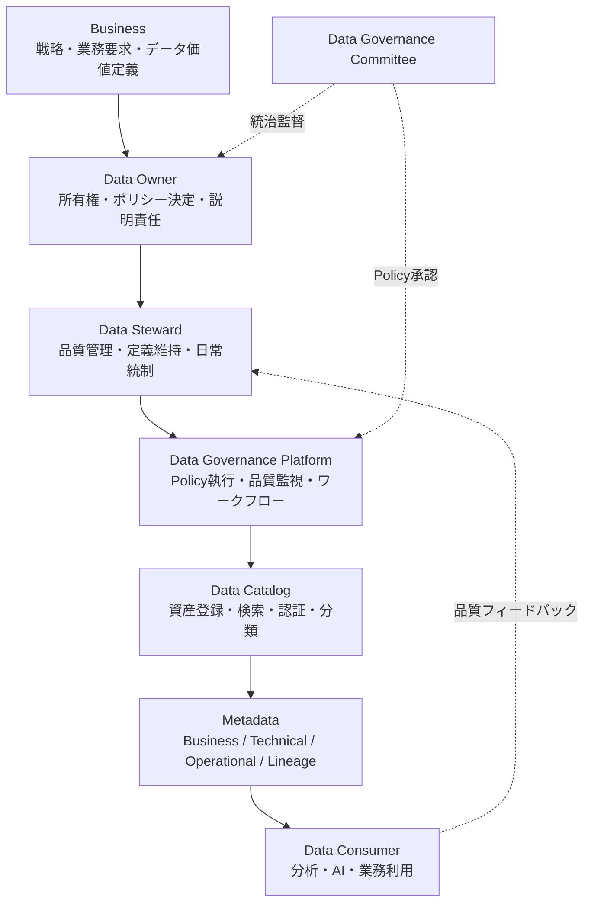
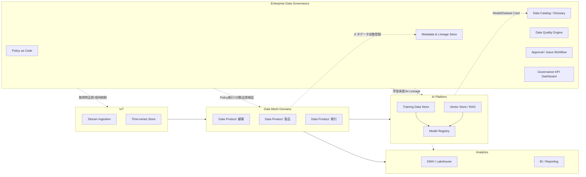

# Enterprise Data Governance Framework 設計書

| 項目 | 内容 |
|---|---|
| 文書名 | Enterprise Data Governance Framework 設計書 |
| 版 | 1.0 |
| 位置付け | Cloud Agnostic / 製品非依存の全社データ統治基準(10年利用を想定) |
| 対象データ | Business / Master / Reference / Transactional / AI / IoT / Analytics / Metadata |

## 設計思想(全章共通の判断原則)

Data as a Product、Single Source of Truth、Data Quality by Design、Metadata First、Federated Governance、Privacy by Design、Security by Design、Lifecycle Management、Continuous Data Quality、Business Ownership の10原則を全設計判断の上位基準とする。

## 関連ディシプリンとの役割分離(出力条件対応)

| 領域 | 対象 | 本Frameworkとの関係 |
|---|---|---|
| Data Governance(本書) | データの品質・所有権・ポリシー・ライフサイクル・統制 | 「誰が・どのルールで・どの品質で」を定義する統治層 |
| Common Data Model (CDM) | エンティティ・属性・関係の構造定義(意味とスキーマ) | CDMは「データの形」を定義し、Governanceは「データの扱い」を定義する。CDMはGovernanceの被統制対象(標準スキーマ資産)であり、Governance PolicyがCDMの変更管理・命名・品質基準を統制する |
| Data Mesh | ドメイン分散型のデータ提供アーキテクチャ | MeshはData Productの提供構造、GovernanceはGlobal Policyと連邦統制を提供。Meshが実行、Governanceが統制(第15章) |
| Knowledge Management | 文書・ノウハウ・暗黙知など非構造の知識 | 対象が異なる。KMは人の知識の共有が目的、本書は構造化・半構造化データ資産の統治が目的。用語集(Glossary)のみ接点を持つが管理主体は分離する |

本書はBusiness視点のデータ統治を中心に設計する。技術統制はBusiness Ownership・Business Valueの実現手段として位置付ける。

---

# 1. 要件定義

## 1.1 Data Governanceとは
データを企業資産として扱い、その品質・所有権・利用・保護・廃棄に関する意思決定権限とルールを定義・執行・監視する経営活動。ツール導入ではなく、役割・プロセス・ポリシー・メトリクスの体系である。

## 1.2 目的
- データ品質の恒常的担保による意思決定精度の向上
- データ所有権の明確化による説明責任の確立
- 規制対応(個人情報保護・業界規制)の証跡ある遵守
- AI/Analytics活用のための信頼できるデータ供給
- データ重複・サイロ化によるコストの削減

## 1.3 背景
データ量・種類(AI/IoT含む)の急増、規制強化、生成AI活用拡大により、統治なきデータ活用が品質事故・コンプライアンス違反・AIリスクを生む状況にある。

## 1.4 解決する課題
Unknown Owner(所有者不明データ)、品質基準の不在、重複マスタ、リネージ不明による影響分析不能、ポリシーの属人的運用、AI学習データの出所不明。

## 1.5 対象範囲
全社のBusiness Data、Master Data、Reference Data、Transactional Data、AI Data(学習・Embedding・Vector・RAG)、IoT Data、Analytics Data、Metadata。オンプレ・マルチクラウドを問わない。

## 1.6 利用シナリオ
- 新規データ資産の登録・所有者割当・分類
- データ品質問題の検知・是正・エスカレーション
- AI学習データの承認・リネージ記録
- 個人情報の消去要求(Right to Erasure)対応
- 規制監査への証跡提出

## 1.7 対象利用者
Data Owner、Data Steward、Data Custodian、Data Consumer(分析者・AI開発者・業務部門)、Data Governance Committee、監査部門。

## 1.8 品質目標
| 指標 | 目標 |
|---|---|
| Critical Data ElementのOwner割当率 | 100% |
| Data Quality Score(重要データ) | 99%以上 |
| Catalog登録率(対象データ資産) | 95%以上 |
| ポリシー違反是正リードタイム | 30日以内 |

## 1.9 制約事項
特定製品・特定クラウドに依存しない。既存システムの即時改修は前提とせず段階適用とする。ドメインの自律性を過度に制限しない。

## 1.10 非対象範囲
非構造ナレッジ(文書・ノウハウ)の管理(=Knowledge Management)、アプリケーション機能設計、個別ETL実装、CDMのエンティティ詳細定義(別文書)。

## 1.11 設計判断
- **設計理由**: 統治対象と非対象を先に確定しないと、KMやCDMと責務が混線しFrameworkが肥大化するため。
- **採用基準**: Business価値・規制要求・リスクの3軸で対象範囲を選定。
- **トレードオフ**: 範囲を広げるほど網羅的だが導入負荷増。重要データ優先の段階適用で緩和。
- **代替案**: 全データ一括統治(Big Bang)→変化に追随できず却下。IT主導の技術統制のみ→Business Ownership原則に反し却下。
- **アンチパターン**: 目的なきツール導入先行、全データ均一統制、統治部門の孤立。

---

# 2. Enterprise Data Governance Architecture Overview

## 2.1 アーキテクチャ構造
BusinessがデータのValueと責任の起点となり、Data Owner→Data Stewardの人的統治、Data Governance Platform→Data Catalog→Metadataの基盤統治を経て、Data Consumerが統制されたデータを利用する多層構造とする。

## 2.2 各層の責務
| 層 | 責務 |
|---|---|
| Business | データ価値・優先度・受容リスクの決定 |
| Data Owner | ドメインデータの最終責任、アクセス・品質基準の承認 |
| Data Steward | 品質監視・用語定義・問題是正の実務 |
| Governance Platform | Policy as Codeによる自動執行・監査証跡 |
| Data Catalog | 発見可能性・信頼性表示(Certification) |
| Metadata | すべての統制判断の根拠情報 |
| Data Consumer | 利用規約遵守・品質フィードバック |

## 2.3 設計判断
- **設計理由**: 人的統治(Owner/Steward)と機械的統制(Platform/Catalog)を分離し、判断は人・執行は自動化とすることで10年間の技術変化に耐える。
- **採用基準**: 各層が製品非依存の責務定義であること、Business起点であること。
- **トレードオフ**: 多層化で責任は明確になるが伝達コスト増。Platformのワークフロー自動化で緩和。
- **代替案**: 中央IT一元統治→スケールせず却下。完全分散→標準喪失のため連邦型を採用。
- **アンチパターン**: Catalogだけ導入して人的役割を定義しない、Platformを特定製品名で定義する。

---

# 3. Data Classification

## 3.1 分類体系
| 分類 | 定義 | 特性 | 統治重点 |
|---|---|---|---|
| Master Data | 顧客・製品・組織など業務横断の基幹実体 | 低頻度更新・高共有性 | Golden Record、重複排除 |
| Reference Data | コード・区分値・通貨など標準化された参照値 | 極低頻度更新・全社共通 | 標準管理・変更統制 |
| Transactional Data | 受注・支払等の業務イベント記録 | 高頻度生成・不変性 | 完全性・保持期間 |
| Analytical Data | 集計・派生・KPIデータ | 再生成可能 | リネージ・鮮度 |
| Operational Data | 業務システムの稼働データ・ログ | 大量・短寿命 | ライフサイクル・コスト |
| AI Data | 学習・Embedding・Vector・RAG用データ | 由来依存・偏り リスク | 出所・承認・AI Lineage |
| IoT Data | センサー・デバイス時系列データ | 超大量・ストリーム | 取得時品質・保持階層化 |
| Metadata | データに関するデータ | 全分類の統制基盤 | 完全性・自動収集 |

各分類に機密度ラベル(Public / Internal / Confidential / Restricted)を直交軸として付与する(第11章)。

## 3.2 設計判断
- **設計理由**: 分類ごとに品質基準・保持・保護の統制強度が異なるため、統制設計の前提として分類を確定する。
- **採用基準**: 更新特性・共有範囲・リスクが明確に区別できる分類のみ採用。
- **トレードオフ**: 分類が細かいほど統制精度は上がるが運用負荷増。8分類+機密度4段階を上限とする。
- **代替案**: 機密度のみの単軸分類→品質・ライフサイクル統制に使えず却下。
- **アンチパターン**: 分類の重複定義、担当者ごとの独自分類、AI DataをAnalytical Dataと混同する。

---

# 4. Data Ownership

## 4.1 役割定義
| 役割 | 責務 | 所属 |
|---|---|---|
| Data Owner | データ資産の最終責任者。品質基準・アクセス・利用可否の承認 | 業務部門長(Business) |
| Data Steward | 定義・品質・問題管理の実務。OwnerとCustodianの橋渡し | 業務部門(専任/兼任) |
| Data Custodian | 保管・保護・バックアップ等の技術的管理 | IT部門 |
| Data Consumer | 規約に従った利用、品質問題の報告 | 全社 |
| Data Governance Committee | Policy承認・裁定・投資判断・成熟度監督 | 経営層+各ドメイン代表 |

## 4.2 RACI
| 活動 | Owner | Steward | Custodian | Consumer | Committee |
|---|---|---|---|---|---|
| Policy策定 | C | C | C | I | A/R |
| 品質基準定義 | A | R | C | I | I |
| 品質監視・是正 | A | R | C | I | I |
| アクセス承認 | A/R | C | R(実装) | I | I |
| 分類・機密度付与 | A | R | C | I | I |
| ライフサイクル実行 | A | C | R | I | I |
| 例外承認 | R | C | I | I | A |

## 4.3 設計判断
- **設計理由**: Business Ownership原則の中核。所有権不在はすべての統制の失敗原因となるため、役割を組織横断で標準化する。
- **採用基準**: OwnerはBusiness側であること、1データ資産に必ず1 Owner(Accountable単一)であること。
- **トレードオフ**: 業務部門の負荷増と統制実効性。Steward配置とPlatform自動化で負荷を軽減。
- **代替案**: IT部門をOwnerとする→業務判断ができず却下。共同Owner→責任霧散のため禁止。
- **アンチパターン**: Unknown Owner、名目だけのOwner任命、Custodianへの責任転嫁、退職時の引継ぎ欠落。

---

# 5. Data Quality Framework

## 5.1 品質ディメンション
| ディメンション | 定義 | 測定例 |
|---|---|---|
| Accuracy | 現実の値と一致している | 検証済ソースとの照合率 |
| Completeness | 必須項目が欠損なく存在する | 必須項目充足率 |
| Consistency | システム間・期間で矛盾がない | クロスシステム一致率 |
| Timeliness | 必要な時点で最新である | 更新遅延(SLA内比率) |
| Validity | 定義された形式・範囲に適合する | ルール適合率 |
| Uniqueness | 重複レコードがない | 重複率 |
| Integrity | 参照関係が保たれている | 参照整合違反件数 |

## 5.2 Quality by Design / Continuous Data Quality
品質ルールはデータ生成パイプラインに組み込み(入口検証)、稼働後も継続監視する。Critical Data Element(CDE)をOwnerが指定し、CDEに品質SLAと閾値・アラート・是正ワークフローを必須設定する。

## 5.3 Quality KPI
Quality Score(ディメンション加重合成、目標99%)、CDEルール網羅率100%、品質Issue平均是正日数、品質起因インシデント件数。第17章のKPI体系に統合する。

## 5.4 設計判断
- **設計理由**: 品質を下流で修正するコストは入口検証の数倍に達するため、Quality by Designを構造化する。
- **採用基準**: 7ディメンションはISO 8000/DAMA系の業界標準に整合し測定自動化が可能なもの。
- **トレードオフ**: 全項目測定はコスト過大。CDE優先のリスクベース適用とする。
- **代替案**: 事後クレンジング中心→Continuous原則に反し補助手段に格下げ。
- **アンチパターン**: 測定なき品質宣言、閾値なきダッシュボード、是正責任者不在のアラート放置。

---

# 6. Metadata Management

## 6.1 メタデータ種別
| 種別 | 内容 | 主管 |
|---|---|---|
| Business Metadata | 業務定義・用語・Owner・利用目的・機密度 | Steward |
| Technical Metadata | Schema・型・物理配置・API仕様 | Custodian(自動収集) |
| Operational Metadata | 更新日時・件数・品質スコア・ジョブ実行結果 | Platform(自動収集) |
| Lineage Metadata | 由来・変換・依存関係 | Platform(自動収集) |

## 6.2 構成要素
- **Schema**: 構造定義。CDMが標準スキーマを定義し、メタデータ管理はその登録・版管理・準拠検証を担う(役割分離)。
- **Catalog**: メタデータの統合公開面(第7章)。
- **Glossary**: Business用語の唯一の定義集。用語→データ資産へのマッピングを必須とする。KMの文書ナレッジとは別管理とし、Glossaryのみを共有接点とする。

## 6.3 Metadata First原則
データ資産はメタデータ登録なしに本番利用不可(No Metadata, No Production)。Technical/Operational/Lineageは自動収集を原則とし、人手入力はBusiness Metadataに限定する。

## 6.4 設計判断
- **設計理由**: メタデータはすべての統制(品質・セキュリティ・ライフサイクル・AI統治)の判断根拠であり、最初に整備すべき基盤。
- **採用基準**: 自動収集可能性、標準交換形式(オープンなlineage/catalog標準)への対応可能性。
- **トレードオフ**: 登録必須化は初期リリース速度を下げる。自動収集+最小必須項目(Owner・定義・分類)で緩和。
- **代替案**: 手動Excel台帳→陳腐化必至で却下。
- **アンチパターン**: 手入力依存の技術メタデータ、更新されないGlossary、メタデータのサイロ(ツール毎分散)。

---

# 7. Data Catalog

## 7.1 機能設計
| 機能 | 設計 |
|---|---|
| Discovery | 全データ資産の自動スキャン・登録。未登録資産の検出 |
| Search | 業務用語・タグ・Owner・分類による横断検索。Glossary連動 |
| Classification | 第3章の分類+機密度ラベルの付与・自動推定・Steward承認 |
| Ownership | 全資産にOwner/Steward表示。不在資産のアラート |
| Certification | Certified(品質SLA充足+Owner承認)/ Draft / Deprecated の信頼性ラベル |
| Lifecycle | 資産の状態(Active/Archive/削除予定)と保持期限の可視化 |

## 7.2 運用原則
Data as a Product原則に基づき、CatalogはデータのProductページ(定義・品質・SLA・利用条件・連絡先)として機能する。ConsumerはCertifiedデータの利用を原則とする。

## 7.3 設計判断
- **設計理由**: 発見不能なデータは存在しないのと同義であり、SSOT実現にはCertificationによる「信頼の表示」が不可欠。
- **採用基準**: 自動Discovery能力、Lineage統合、製品乗換可能なメタデータエクスポート。
- **トレードオフ**: Certification審査は流通速度を下げる。Draft利用を分析用途に限定許可して両立。
- **代替案**: Wiki/共有フォルダによる台帳→検索性・鮮度で却下。
- **アンチパターン**: 登録して終わりのCatalog(No Catalog状態と同義)、Certificationなき全量公開、検索されないUI。

---

# 8. Master Data Management

## 8.1 設計
- **Master Data**: ドメインごとにOwnerを定め、全社共有マスタ(顧客・製品・組織・取引先)を特定。
- **Golden Record**: SSOT実現の中核。ソース別信頼度ルール+サバイバルシップルールで唯一の正を生成し、生成ロジックをメタデータとして公開。
- **Reference Data**: 全社標準コードは中央管理・配布。外部標準(ISO国コード等)は取込元と版を管理。
- **Deduplication**: 確定一致+確率的マッチングの2段階。閾値未満はSteward裁定キューへ。
- **Synchronization**: Golden Recordから利用システムへの配信(イベント駆動を推奨、パターンとして規定し製品非依存)。逆流更新は変更申請経由のみ。
- **Versioning**: マスタ変更履歴の全件保持。時点参照(as-of)可能とする。

## 8.2 設計判断
- **設計理由**: 重複マスタは品質・分析・顧客体験すべての障害源。SSOTのうちマスタ領域を担う実装ディシプリン。
- **採用基準**: Golden Record生成規則がOwner承認済で説明可能であること。
- **トレードオフ**: 中央集約型は整合性最強だが導入負荷大。共存型(Registry→Consolidation→段階的にCoexistence)で段階導入。
- **代替案**: 各システム独立マスタ+連携マッピングのみ→重複温存で却下。
- **アンチパターン**: Duplicate Master Data、裁定ルールなき自動マージ(誤マージ)、履歴なき上書き更新。

---

# 9. Data Lineage

## 9.1 設計
| 要素 | 設計 |
|---|---|
| Source | 起点システム・取得契約・取得時点の記録 |
| Transformation | 変換ロジック(結合・集計・クレンジング)の論理記述と実装参照 |
| Pipeline | ジョブ・依存関係・実行履歴の自動収集 |
| Destination | 到達先(DWH・データプロダクト・AIモデル・帳票)の記録 |
| Impact Analysis | 変更時の下流影響の自動特定(スキーマ変更・廃止時に必須実行) |
| Traceability | 任意のデータ項目から起点まで遡及可能(監査・障害・AI説明に使用) |

粒度はテーブル/データセットレベルを必須、CDEはカラムレベルを必須とする。収集はパイプライン実行時の自動収集を原則とし、オープンなリネージ標準形式での蓄積により製品非依存性を確保する。

## 9.2 設計判断
- **設計理由**: リネージなき変更は影響不明のまま本番破壊を起こす。監査証跡・AI説明責任の基盤でもある。
- **採用基準**: 自動収集率、標準形式対応、Catalogとの統合表示。
- **トレードオフ**: カラムレベル全面適用は収集コスト過大。CDE限定で費用対効果を確保。
- **代替案**: 設計書ベースの手動リネージ→実装乖離で却下(補助資料扱い)。
- **アンチパターン**: No Lineage、手動更新頼みの図、収集するが誰も見ない(Impact Analysisのプロセス未接続)。

---

# 10. Data Lifecycle

## 10.1 ライフサイクル段階と統制
| 段階 | 統制内容 |
|---|---|
| Create | 入口品質検証、分類・Owner・メタデータ付与(Metadata First) |
| Store | 分類に応じた保護(暗号化・アクセス制御)、階層ストレージ |
| Use | 目的内利用、アクセスログ、品質監視 |
| Share | 利用規約・契約に基づく提供、社外提供はOwner+Committee承認 |
| Archive | アクセス頻度低下データの低コスト層移行、検索可能性の維持 |
| Delete | 保持期限到達・消去要求時の確実な削除(全複製・バックアップ含む)と削除証跡 |

## 10.2 Retention
分類×規制要件×業務要件から保持スケジュール(Retention Schedule)をOwnerが定義し、Platformが自動執行する。法的保全(Legal Hold)は削除より優先する。

## 10.3 設計判断
- **設計理由**: ライフサイクル未管理は保管コスト膨張と規制違反(過剰保持)の双方を招く。Privacy by Designの消去要求対応の前提。
- **採用基準**: 保持ルールが宣言的に定義でき自動執行可能なこと。
- **トレードオフ**: 早期削除は再利用機会を失う。Archive段階を挟み復元可能期間を設ける。
- **代替案**: 無期限全量保持→コスト・規制両面で却下。
- **アンチパターン**: 削除されない「念のため保持」、バックアップに残る削除済データ、保持期限の未定義。

---

# 11. Data Security

## 11.1 設計
| 統制 | 設計 |
|---|---|
| Classification | 機密度4段階(Public/Internal/Confidential/Restricted)を全資産に必須付与。統制強度を機密度に連動 |
| Encryption | 保存時・転送時の暗号化を全分類で必須。鍵管理は利用側と分離(製品非依存のKMSパターン) |
| Masking | Confidential以上の非本番利用・画面表示は動的/静的マスキング必須 |
| Tokenization | 決済情報等、原本参照が不要な高機密項目はトークン化し原本を隔離 |
| Access Control | RBAC+属性(ABAC)併用。最小権限、Owner承認、定期棚卸(四半期)。ポリシーはPolicy as Codeで一元定義 |
| Data Loss Prevention | 機密ラベル連動の持出検知・遮断。社外共有はShare統制(第10章)と連動 |

## 11.2 設計判断
- **設計理由**: Security by Design原則。分類駆動で統制を自動連動させることで、人的判断のばらつきを排除する。
- **採用基準**: 分類ラベルから保護統制が機械的に導出できること。
- **トレードオフ**: 高統制は利用摩擦を生む。機密度に応じた段階統制で過剰防御を回避。
- **代替案**: システム単位の境界防御のみ→データ移動に追随できず却下(データ中心保護を採用)。
- **アンチパターン**: 全データ最高機密扱い(実質統制不能)、マスキングなき本番コピーの検証利用、棚卸なき権限の堆積。

---

# 12. Data Privacy

## 12.1 設計
| 統制 | 設計 |
|---|---|
| PII | PII項目の自動検出+Steward確認によるインベントリ化。処理目的・法的根拠を記録 |
| Consent | 同意の取得・変更・撤回を記録し、利用時に同意状態を照合(目的外利用の遮断) |
| Retention | PIIは目的達成後の保持を禁止。第10章Retention Scheduleに privacy要件を統合 |
| Right to Erasure | 消去要求を受理→対象特定(Lineage活用)→全所在からの削除→証跡発行を標準プロセス化 |
| Anonymization | 統計・研究用途は再識別不能な匿名化(k-匿名性等の基準を規定)。匿名化後は個人データ統制外 |
| Pseudonymization | 分析・AI用途の既定手法。キー分離保管を必須とし、個人データとしての統制は継続 |

## 12.2 設計判断
- **設計理由**: Privacy by Design原則。事後対応では消去要求・監査に応答不能。PII所在の把握(インベントリ+Lineage)が全対応の前提。
- **採用基準**: GDPR級の最も厳格な規制水準をベースラインとし、地域規制は追加プロファイルで対応(10年耐性)。
- **トレードオフ**: 匿名化は分析価値を毀損しうる。用途別に匿名化/仮名化を使い分ける。
- **代替案**: 規制ごとの個別対応→重複投資と漏れが生じ却下。
- **アンチパターン**: 同意なき目的外利用、仮名化を匿名化と誤認して統制解除、消去要求時の複製残存。

---

# 13. Data Compliance

## 13.1 設計
| 要素 | 設計 |
|---|---|
| Policy | 全社Data Policy体系(品質・分類・保持・プライバシー・AI利用)。Committee承認、年次見直し |
| Audit | 内部監査(半期)+Platform自動監査(常時)。監査項目はPolicyから導出 |
| Compliance | 規制要件→Policy→統制→証跡のトレーサビリティマトリクスを維持 |
| Exception | Policy例外は期限付き・リスク評価付きで申請。恒久例外は禁止 |
| Approval | 例外・社外提供・AI学習利用はワークフローで承認し記録 |
| Evidence | すべての統制実行(アクセス・削除・承認・品質検査)を改ざん不能な証跡として保存 |

## 13.2 設計判断
- **設計理由**: 「遵守している」ではなく「証明できる」状態が監査・規制対応の要件。証跡自動生成を統制設計に組み込む。
- **採用基準**: 統制がPolicyに遡及でき、証跡が自動生成されること。
- **トレードオフ**: 例外プロセスの厳格化は現場速度を下げる。期限付き例外+自動失効で機動性を確保。
- **代替案**: 監査前の一斉証跡収集→網羅性なく却下。
- **アンチパターン**: 文書だけのPolicy(執行なし)、無期限例外の常態化、証跡の手作業スクリーンショット。

---

# 14. Data Governance & AI

## 14.1 設計
| 対象 | 統制 |
|---|---|
| Training Data | 学習利用前にOwner承認・ライセンス/同意確認・品質検査・バイアス評価を必須化。学習データセットを版管理 |
| Embedding Data | 生成元データの機密度を継承。PII含有元からのEmbeddingは仮名化後に限定 |
| Vector Data | Vector Store内も分類・アクセス制御・削除の統制対象(消去要求時は該当ベクトルも削除) |
| RAG Data | RAG参照コーパスはCertifiedデータに限定。アクセス制御を検索時に適用(利用者権限の透過) |
| AI Metadata | モデル・データセット・プロンプト資産をCatalogに登録(Model/Dataset Card) |
| AI Lineage | 「ソース→学習データ→モデル版→出力」の系譜を記録し、データ汚染・リコール時にモデル影響を特定可能とする |

## 14.2 設計判断
- **設計理由**: AIは劣化データ・無承認データを増幅する。既存統制(分類・品質・リネージ・プライバシー)をAI資産へ拡張適用することで、AI固有の統治新設を最小化する。
- **採用基準**: 派生物(Embedding/Vector)が元データの統制属性を継承できること。
- **トレードオフ**: 学習前審査はAI開発速度を下げる。Certifiedデータの事前プール化で審査を先行消化。
- **代替案**: AI統治を別Frameworkとして分離→二重統治となり却下(本Frameworkの拡張として統合)。
- **アンチパターン**: 出所不明データでの学習、Vector Storeの統制外運用、消去要求時のEmbedding残存、モデルと学習データの紐付け欠落。

---

# 15. Data Governance & Data Mesh

## 15.1 役割分担
Data Meshは「ドメインがData Productを所有・提供する実行アーキテクチャ」、本Frameworkは「全ドメイン共通のGlobal Policyと連邦統制」を提供する。統治なきMeshはサイロの再生産、Meshなき中央統治はボトルネックとなる。

| 要素 | 設計 |
|---|---|
| Federated Governance | Global Policy(分類・機密度・品質最低基準・相互運用標準)は中央=Committeeが定義、実装・運用はドメインが自律実行。Policy as Codeでプラットフォームに埋め込み自動執行 |
| Domain Ownership | 第4章のData Ownerをドメイン単位に配置。ドメインがProductのSLA・品質に責任 |
| Data Product | Discoverable / Addressable / Trustworthy / Self-describing / Interoperable / Secure を出荷基準とし、Catalog Certificationで検証 |
| Global Policy | 全ドメイン共通:分類体系・PII統制・保持・監査証跡・命名/ID標準。ドメインはこれに上乗せのみ可(緩和不可) |
| Standardization | ドメイン間相互運用のためのスキーマ標準はCDMが提供し、Governanceは準拠を検証(役割分離) |

## 15.2 設計判断
- **設計理由**: Federated Governance原則の具体化。中央の一貫性とドメインの俊敏性を両立する唯一の現実解。
- **採用基準**: Global/Domainの責務境界が文書化され、Global Policyが自動執行可能であること。
- **トレードオフ**: 連邦型は調整コストが増す。Policyの機械執行と例外プロセスで調整を最小化。
- **代替案**: 中央集権統治→スケール限界。完全自治→標準喪失。いずれも却下。
- **アンチパターン**: Global Policyなき「なんちゃってMesh」、ドメインごとの独自分類体系、中央がProduct実装まで抱え込む。

---

# 16. Governance Process

## 16.1 プロセス設計
| プロセス | 設計 |
|---|---|
| Policy | 起案(Steward/Owner)→影響評価→Committee承認→公開→執行(自動)→年次見直し |
| Approval | アクセス・例外・社外提供・AI利用の承認ワークフロー。SLA(例:アクセス承認3営業日)を設定 |
| Review | 四半期:品質KPI・権限棚卸。年次:Policy・分類・Owner割当の総点検 |
| Change | データ資産・スキーマ変更はImpact Analysis(第9章)必須→下流Owner通知→承認→実施 |
| Issue | 品質・統制違反Issueの登録→優先度付け→是正担当(Steward)→クローズ検証 |
| Escalation | Steward解決不能→Owner→ドメイン間対立・投資判断はCommittee裁定。各段階に期限を設定 |

## 16.2 設計判断
- **設計理由**: 統治は一度きりの設計ではなく継続プロセス。判断ルート・期限を定めないと統治が停滞し形骸化する。
- **採用基準**: 全プロセスがワークフローで記録され証跡化されること(第13章連動)。
- **トレードオフ**: プロセス厳格化と現場速度。低リスク操作は自動承認・事後監査に切替えて緩和。
- **代替案**: 会議体ベースの都度判断→再現性なく却下。
- **アンチパターン**: 承認者不明のワークフロー、期限なきIssueの滞留、Escalation経路の未定義。

---

# 17. KPI / Metrics

## 17.1 KPI体系
| KPI | 定義 | 目標例 | 責任 |
|---|---|---|---|
| Quality Score | CDEの品質ディメンション加重合成 | 99%以上 | Steward |
| Completeness | 必須メタデータ・必須項目の充足率 | 95%以上 | Steward |
| Freshness | SLA内に更新されたデータ資産比率 | 98%以上 | Custodian |
| Usage | Certifiedデータの利用率・利用者数(価値の代理指標) | 増加傾向 | Owner |
| Issue Count | 未解決Issue数・平均是正日数 | 是正30日以内 | Steward |
| Compliance Rate | Policy準拠率(自動監査合格率)、Owner割当率 | 100% | Owner/Committee |

ダッシュボードでドメイン別・分類別に常時可視化し、Committeeレビュー(四半期)の一次資料とする。

## 17.2 設計判断
- **設計理由**: 測定なき統治は改善不能。統治活動自体をKPIで統治する(メタ統治)。
- **採用基準**: 自動算出可能であること、Business価値(Usage)を含むこと。
- **トレードオフ**: KPI過多は形骸化。6指標+ドメイン任意指標に限定。
- **代替案**: 監査指摘件数のみ→事後指標に偏り却下。
- **アンチパターン**: 目標なき測定、数値操作を誘発する単一KPI偏重、誰も見ないダッシュボード。

---

# 18. Reference Architecture

## 18.1 全体構成

## 18.2 構成原則
Governance層は横断制御面(Control Plane)であり、データ本体は保持しない。各プラットフォーム(Mesh/AI/Analytics/IoT)はデータ面(Data Plane)として、メタデータ登録・Policy準拠・証跡送出の3点でGovernance層と接続する。接続仕様はオープン標準(メタデータ/リネージ交換形式、ポリシー記述)に限定し、製品交換可能性を担保する。

## 18.3 設計判断
- **設計理由**: Control Plane / Data Plane分離により、10年間のデータ基盤の入替(クラウド移行・製品変更)に対して統治資産(Policy・メタデータ・証跡)を保全できる。
- **採用基準**: 各Data Planeがオープン標準で接続できること。
- **トレードオフ**: 分離構造は統合密度の高い単一製品スイートより初期構築コスト大。ロックイン回避を優先。
- **代替案**: 単一ベンダースイートへの全面依存→Cloud Agnostic要件に反し却下。
- **アンチパターン**: Data PlaneごとのGovernance分立、Control Planeへのデータ本体集約、独自形式でのメタデータ蓄積。

---

# 19. 非機能要件

| 要件 | 設計基準 |
|---|---|
| Availability | Governance Platform 99.9%。Catalog/Policy執行停止時もデータ利用は継続可能(fail-open範囲をリスク別に定義、認可はfail-close) |
| Integrity | メタデータ・証跡の改ざん防止(追記型・署名)。Policy版管理と整合検証 |
| Security | Governance Platform自体を Restricted 相当で保護。管理者操作の全記録 |
| Scalability | 資産数百万件・イベント毎秒万件級のメタデータ/リネージ収集に水平拡張で対応 |
| Auditability | すべての統制判断・実行が5W1Hで再構成可能。証跡保持は規制要件以上 |
| Maintainability | Policy as Codeのテスト・段階リリース。役割定義の年次更新プロセス |
| Observability | 収集パイプライン・品質ジョブ・ワークフローのSLI/SLO監視とアラート |

- **設計理由**: 統治基盤自体が停止・改ざんされれば全統制が無効化するため、統治基盤を最重要システムとして扱う。
- **採用基準/トレードオフ**: 認可fail-close・参照fail-openの使い分けで安全性と可用性を両立。
- **代替案**: ベストエフォート運用→監査要件を満たせず却下。
- **アンチパターン**: 統治基盤のみ監視対象外、証跡DBの上書き可能運用。

---

# 20. Data Governance Maturity Model

| Level | 名称 | 状態 | 到達条件(主要) |
|---|---|---|---|
| 0 | No Governance | 所有者・ポリシー・カタログ不在。個人依存 | - |
| 1 | Basic Policy | 基本Policy文書とCommitteeが存在。執行は手動・部分的 | Policy承認、主要データのOwner任命 |
| 2 | Managed | 重要ドメインでCatalog・品質測定・Ownershipが運用 | CDE定義、Quality KPI測定開始 |
| 3 | Standardized | 全社標準(分類・プロセス・KPI)が全ドメイン適用。Policy as Code執行 | Catalog登録率95%、自動監査稼働 |
| 4 | Federated Governance | ドメイン自律統治+Global Policy。Data Product運用が定着 | 連邦体制・Certification流通の定着 |
| 5 | Autonomous Governance | 品質検知・分類・是正の大部分が自動化。統治が自己改善 | 自動是正率・予測的品質管理の実現 |

運用指針:年次で成熟度評価を行い、1レベルずつ引き上げる(飛び級しない)。ドメイン別に評価し、先行ドメインをリファレンスとする。

- **設計理由**: 到達像と現在地の共通言語がないと投資判断と優先順位付けができない。
- **採用基準**: 各レベルが検証可能な到達条件(KPI連動)を持つこと。
- **トレードオフ**: 段階導入は全社完成まで時間を要するが、Big Bangの失敗リスクを回避。
- **代替案**: 一律即Level 4導入→組織変化が追随せず却下。
- **アンチパターン**: 自己申告だけの成熟度評価、レベル達成自体の目的化。

---

# 21. ベストプラクティス

| プラクティス | 要点 |
|---|---|
| Business Ownership | OwnerはBusiness側に置き、経営指標(Usage・価値)で統治を評価する。任命は職位に紐付け引継ぎを制度化 |
| Metadata First | 「No Metadata, No Production」。自動収集を最大化し、人手はBusiness Metadataに集中 |
| Data Quality | 入口検証(by Design)+継続監視(Continuous)。CDE優先のリスクベースで費用対効果を確保 |
| Data Catalog | CatalogをデータのProductページとして運用し、Certificationで信頼を流通させる。検索されるCatalogだけが生きる |
| Continuous Governance | 統治を一過性プロジェクトでなく常設プロセス(Policy見直し・KPIレビュー・成熟度評価の年次サイクル)として運営する |

共通原則:小さく始めて標準で広げる(重要ドメイン先行→Global Policy化)、人・プロセス・技術の三位一体(ツール単独導入を禁止)。

---

# 22. アンチパターン

| アンチパターン | 症状 | 対策(本書参照) |
|---|---|---|
| Unknown Owner | 所有者不明で品質・アクセス判断が停止 | Owner割当率100% KPI、不在資産アラート(第4・7章) |
| No Catalog | データが発見不能で重複作成が横行 | 自動Discovery・登録必須化(第7章) |
| Poor Quality | 検証なきデータで意思決定・AIが劣化 | Quality by Design・CDE SLA(第5章) |
| Duplicate Master Data | 顧客・製品の多重定義で全社集計不能 | Golden Record・Deduplication(第8章) |
| No Lineage | 変更影響不明・監査応答不能 | 自動リネージ・Impact Analysis必須化(第9章) |
| No Governance | ルール不在の自由利用がリスクを蓄積 | 成熟度Level 1からの段階導入(第20章) |

派生アンチパターン:ツール先行導入(プロセス不在)、全データ均一統制(重要度無視)、無期限例外、統治部門の現場乖離。いずれも「Business Ownership・リスクベース・自動執行」の3原則への回帰で是正する。

---

*本書は年次レビュー(第16章)により改訂し、版管理のうえ10年間の全社基準として維持する。*
